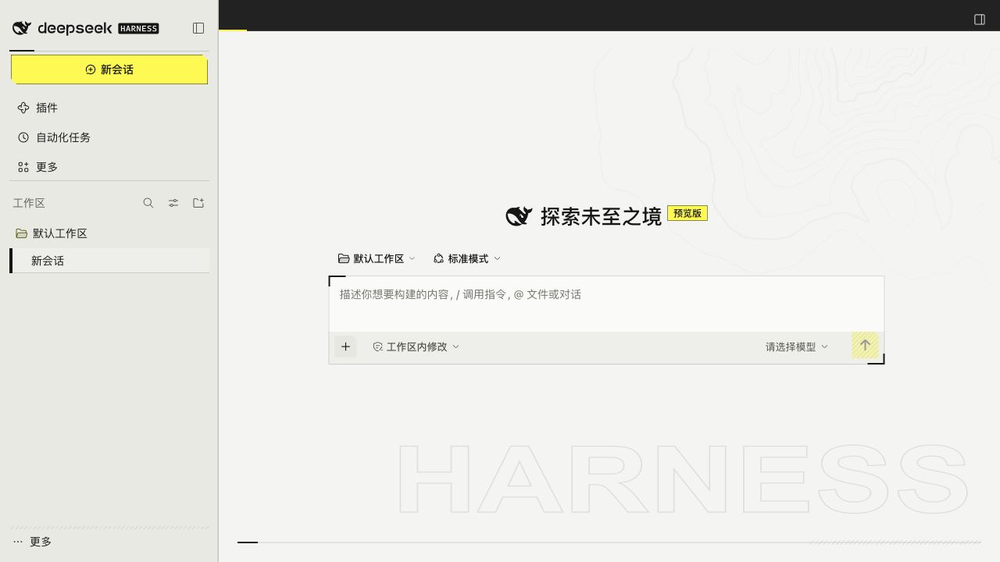
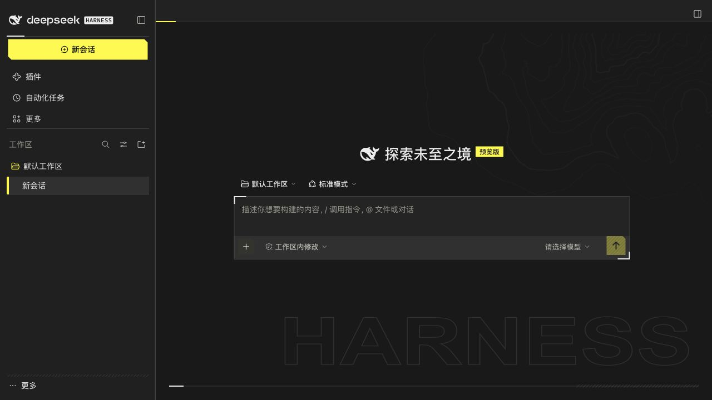

# dsh-skin-endfield

DeepSeek Harness 的终末地风格皮肤，保留 DSH 的原有布局、字体与字号。

<!-- dsh-compatibility:start -->
**最新实测适配的 DSH 版本：`0.2.1-rc.5`**

当前皮肤版本：**v0.2.1**。已通过桌面与隔离实例验证。

[下载插件 ZIP](releases/dsh-skin-local-0.2.1.zip) · [发布校验记录](releases/dsh-skin-local-0.2.1.verification.json)
<!-- dsh-compatibility:end -->

实际验证平台为 macOS 桌面版。这里记录的是已完成验证的版本；DSH 升级后需要重新验证兼容性。

本版将深浅主色恢复为 v0.1.0 的纸白 `#F4F4F2` 与炭黑 `#191919`，保留 v0.2.0 的 Rahoo 等高线、HARNESS 描边字标、L 形角线、斜纹和短动效。布局、字体与字号不变。启动时播放 1 秒 **DEEPSEEK HARNESS** 字标动画，支持系统减少动效。没有使用游戏角色图片。

## 成果

- [主色回退、验证范围与使用说明](docs/v0.2.1.md)
- [冻结插件目录](releases/dsh-skin-local-0.2.1/)
- [插件 ZIP](releases/dsh-skin-local-0.2.1.zip)
- [发布校验报告](releases/dsh-skin-local-0.2.1.verification.json)
- [深色界面](qa/v0.2.1/dark-home.png)
- [浅色界面](qa/v0.2.1/light-home.png)
- [启动动画实录](qa/v0.2.0/startup-recording.mp4)

以下预览来自真实 DSH 隔离实例：




## 安装

1. 下载上方 ZIP 并解压，或克隆本仓库。
2. 在 DSH **插件 → 添加插件** 中填写解压后的 `dsh-skin-local-0.2.1` 目录的绝对路径；克隆仓库时使用 `releases/dsh-skin-local-0.2.1` 的绝对路径。
3. 安装后点击 **立即启用**。使用期间保留该目录，DSH 会通过本地链接加载它。

升级已有皮肤时，先在插件管理器卸载旧版，再安装新版，然后完整退出并重新打开 DSH。

## 已验证

8 项自动测试通过，覆盖 100 次启停、减少动效和加载失败回退。真实 DSH 中对比主界面 26 个控件、插件页 33 个、设置页 47 个，位置、尺寸、字体无差异；实际加载样式哈希与构建一致。深浅主题、编辑输入、插件停用恢复及隔离实例冷启动通过。桌面版已验证安装、完整重启、启停、主题切换和输入功能。

[运行验证](qa/v0.2.1/runtime.json) 与 [桌面验证摘要](qa/v0.2.1/desktop.json) 绑定当前包哈希。应用程序文件未修改。没有向模型发送测试消息，也未覆盖所有第三方插件组合。当前结论仅覆盖已测试的 DSH 版本与界面；后续每版沿用相同发布门槛。

**升级注意：** 本次 DSH 热更新出现“列表版本已更新，画面仍为旧样式”的缓存情况。完整退出并重新打开 DSH 后已正确生效；关窗重开不足以替换缓存。

## 开发

需要 Python 3.10+、Node.js，以及当前适配版本的本机 DSH。首次建立本机参考后构建：

```sh
python3 scripts/prepare.py
python3 scripts/catalog.py
python3 scripts/build.py
python3 scripts/check.py
```

完成真实 DSH 验证并保存对应版本证据后：

```sh
python3 scripts/release.py --candidate
# 原生桌面验证并记录 desktop.json
python3 scripts/release.py
python3 scripts/compatibility.py --check
```

**每次正式发布都会自动更新 README 顶部的最新实测 DSH 版本、皮肤版本和下载链接。** 版本来自通过运行与桌面验证的构建记录。GitHub 自动检查会在 README 与已验证发布版本不一致时报错；单独修改 `engines.dsh` 不代表完成适配。维护要求见 [CONTRIBUTING.md](CONTRIBUTING.md)。

发布脚本拒绝过期验证记录和覆写不同内容的同版本包。运行中的 DSH 链接冻结的 `releases/` 目录，后续 `dist/` 构建不会影响它。

皮肤源码：`skin/tokens.json`、`skin/appearance.css`、`skin/details.css`、`skin/client.template.js`。素材来源及字体许可：`skin/assets/`。初始接口分析保留在 [preparation.md](docs/preparation.md)，本版没有将游戏图像嵌入运行包。

## 回退

DSH **插件 → dsh-skin-local → 关闭开关** 即恢复原外观。若以后无法打开界面，先退出 DSH，再从仓库根目录运行：

```sh
python3 scripts/disable-skin.py
```

它会备份 profile 清单，只取消此皮肤的加载，保留其他配置。

上一版 [v0.1.0](docs/v0.1.0.md) 的冻结包仍保留，可卸载新版后通过插件管理器重新添加。
